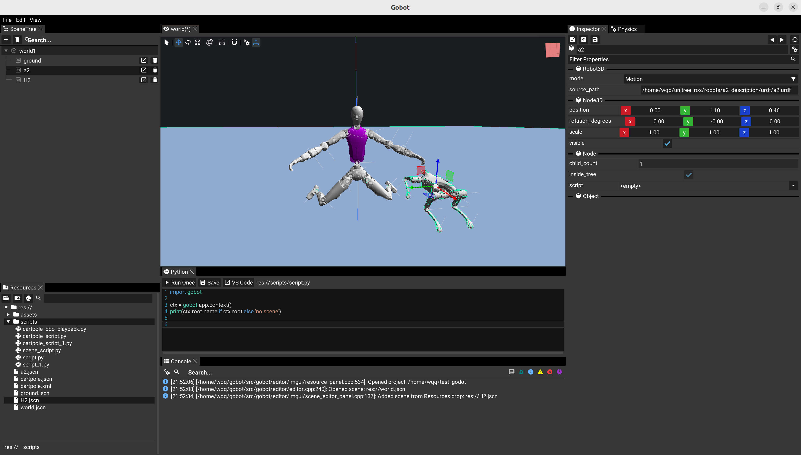
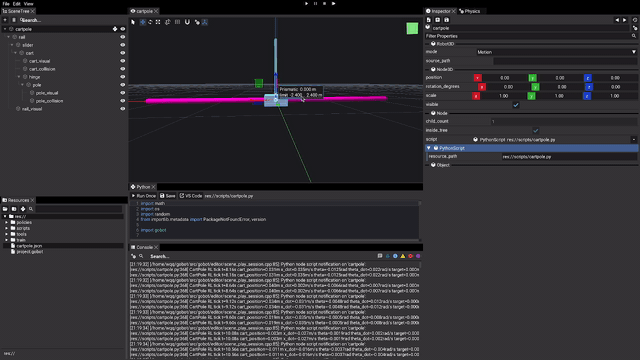
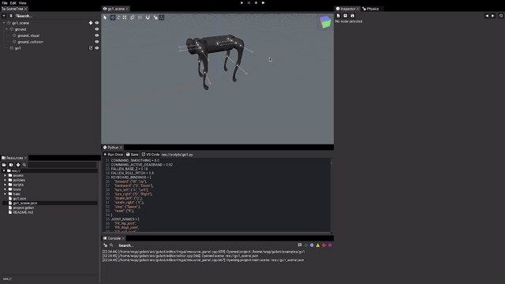

# Gobot

Gobot is a Linux robotics engine for editing scenes, simulating robots, rendering,
and reinforcement learning, with Python as the scripting API.

[](https://pypi.org/project/gobot/)
[](https://github.com/RobSimulatorGroup/gobot/blob/master/LICENSE)
[](https://github.com/RobSimulatorGroup/gobot/actions)



## Install

```bash
pip install gobot
gobot_editor
```

Linux x86_64 wheels include MuJoCo CPU, MuJoCo Warp, Newton, PyTorch,
LuisaCompute rendering, Gaussian Splatting inference, and OpenUSD. There are no
feature extras. GPU features need a compatible NVIDIA driver and system
EGL/OpenGL libraries; wheels do not require a CUDA Toolkit.

Open a packaged project from **Examples** on the editor start screen.

## Python

```python
import gobot

gobot.set_project_path("/path/to/project")
scene = gobot.load_scene("res://world.jscn")
print(scene.root.name)
print(gobot.backend_infos())
```

## Develop from source

Source builds need a C++20 toolchain and, with the default features, a CUDA
Toolkit. See [building](doc/building.md) for prerequisites and CPU-only builds.

```bash
git clone https://github.com/RobSimulatorGroup/gobot.git
cd gobot
uv run gobot_editor --path examples/go1
```

The first run initializes pinned dependencies and builds the editable package.
Later editor launches rebuild native changes incrementally.

## Examples and training

| CartPole | Go1 policy playback |
| --- | --- |
|  |  |

Use the shared training entry for Go1/G1 PPO, G1 AMP, and G1 SuperMimic:

```bash
uv run gobot-train --list
uv run gobot-train go1-velocity \
  --backend mujoco-cpu --num-envs 4 --iterations 10 --no-eval \
  --output logs/go1_cpu
```

Choose `--backend mujoco-warp --device cuda:0` for CUDA simulation. Task registration
is optional: Python factories and ordinary Python scripts use the same launch API.
See the [training guide](doc/gobot_training.md) for reward/algorithm overrides,
backend limits and data preparation, and the [example catalog](doc/examples.md)
for evaluation and policy playback.

## Documentation

- [Documentation index](doc/README.md)
- [Build and test](doc/building.md)
- [Engine architecture](doc/architecture.md)
- [MuJoCo and RL](doc/mujoco_rl_plan.md)
- [Rendering](doc/luisa_rendering_plan.md)
